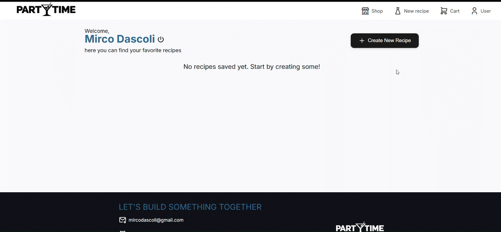

# PARTYTIME

> More than a liquor store — an interactive experience that guides you through the world of spirits, helps you craft unforgettable cocktails, and makes every visit feel like a night out.

---

[Live demo Link 🔗](https://partytime-5tie.onrender.com/)

---

## What is this?

is a full-stack web application that blends e-commerce with entertainment. Users don't just browse and buy — they explore spirits, discover cocktail recipes, and get guided through the art of mixology, all while the store sells more product in the most enjoyable way possible.

---

## Tech Stack

| Layer    | Technology                    |
| -------- | ----------------------------- |
| Frontend | Lit Web Components, HTML, CSS |     |
| Backend  | Node.js, Express              |
| Database | MongoDB                       |

---

## License

software released into the public domain.

Anyone is free to copy, modify, publish, use, compile, sell, or
distribute this software, either in source code form or as a compiled
binary, for any purpose, commercial or non-commercial, and by any
means.

THE SOFTWARE IS PROVIDED "AS IS", WITHOUT WARRANTY OF ANY KIND,
EXPRESS OR IMPLIED, INCLUDING BUT NOT LIMITED TO THE WARRANTIES OF
MERCHANTABILITY, FITNESS FOR A PARTICULAR PURPOSE AND NONINFRINGEMENT.
IN NO EVENT SHALL THE AUTHOR BE LIABLE FOR ANY CLAIM, DAMAGES OR
OTHER LIABILITY, WHETHER IN AN ACTION OF CONTRACT, TORT OR OTHERWISE,
ARISING FROM, OUT OF OR IN CONNECTION WITH THE SOFTWARE OR THE USE OR
OTHER DEALINGS IN THE SOFTWARE.
